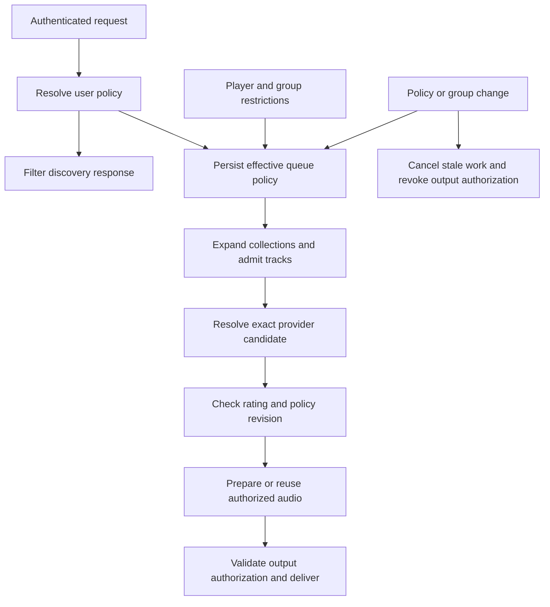

# User and player music content policy

Status: implementation design, not implemented or accepted upstream. Updated 2026-11-04.

Inspected base: Music Assistant server `dev`, commit `c2501db1f6197189d981baf367e43c902569fc20`.

## Decision

Implement an administrator-managed **Allow explicit music** setting per Music Assistant user and player. Playback applies the strictest user, sticky queue, and destination-player policy. User policy filters discovery everywhere; destination policy additionally filters discovery when the client supplies an authorized destination. Albums, playlists, artist playback, and autoplay continue with eligible tracks. Kiosk Satellite keeps its native Music Library and existing Music Assistant user token. Apple Music is the first verified provider, using ratings from existing album responses rather than a second per-track lookup service.

Enforcement belongs in the server, using provider metadata and existing queue/stream machinery. No Kiosk fork, replacement library UI, background skip watcher, external gateway, or runtime monkey patch is required. Until upstream accepts the changes, deployment requires a maintained server build. Small patches reduce rebase effort; they do not eliminate builds. A frontend contribution supplies the setting UI; the server API can configure the first deployment independently.

Queue restrictions are sticky. Once a restricted user starts or contributes music to a queue, ordinary control by another user does not relax it. An authorized unrestricted user must explicitly reset its policy. This is a catalog-rating filter, not lyric analysis or a guarantee of age appropriateness.

## Goals and boundaries

- One policy across providers and clients, including Kiosk search, library, album view, and queue actions.
- No known-explicit recording admitted to a restricted audio path, including fallback, preload, crossfade, and restored playback.
- Preserve source access control, streaming entitlements, rate limits, favorites, synchronization, and unrestricted behavior.
- Keep the evaluator pure, policy context explicit, provider adapters small, and protocol changes additive.
- Never delete tracks from the shared library or edit original service playlists to create a filtered view.

Initial scope is recorded music tracks and containers. Podcast/audiobook age policies, automatic clean-edition substitution, and lyric classification are separate features. Player restrictions are persistent settings for MA-controlled playback, not control over external speaker apps. Existing audiobook and approved story-source access must continue working. Classification uses trusted provider/media identity, never a client claim that music is an audiobook.

External AirPlay, line-in, native speaker apps, and audio already buffered on a speaker are outside the server's ability to retroactively filter. MA-controlled attempts to switch a restricted queue to opaque music URLs or live music must be refused until an authorized user explicitly resets it. Track-resolved provider radio is supported through per-track admission; an opaque continuous stream cannot satisfy this contract. Arbitrary media must not enter through an announcement exception: existing announcement permissions remain separate and cannot be used by a restricted token to submit unrestricted music.

## User experience

Administrators manage the setting on the MA user, not each token or provider. All tokens inherit it. Restricted users can read their effective policy but cannot weaken it through preferences, API fields, token creation, or role changes.

| Action | Restricted behavior |
| --- | --- |
| Search, recommendations, favorites, history, library tracks | Omit known-explicit tracks |
| Open album or playlist | Return eligible tracks in original order and retain original track numbers |
| Play mixed collection | Queue eligible tracks, excluding prohibited entries before audio preparation |
| Play wholly blocked collection | Return content-policy error and preserve the existing queue |
| Play explicit track by URI or supplied media object | Reject with an intelligible error |
| Next, previous, jump, seek, resume, repeat | Revalidate target under queue policy |
| Autoplay | Filter each candidate and stop gracefully when no eligible candidate is found |
| Provider fallback or quality upgrade | Check the actual replacement recording |
| Adult controls restricted queue | Restriction remains until explicit authorized reset |

Artists are not classified as explicit. Mixed containers remain discoverable so users can open eligible tracks. A container rating never proves every child explicit or clean. Omit empty containers when emptiness is known cheaply; do not scan whole catalogs just to render artists. Artwork and titles are not moderated by this feature.

Kiosk does not need custom badges for enforcement. MA frontend may show “Explicit music filtered” and omitted-track counts. Older clients receive compatible errors and filtered collections. Never report successful playback when nothing playable remains.

## Rating semantics

Reuse `MediaItemMetadata.explicit`: `True` is explicit, `False` is reported non-explicit, `None` or missing is unknown. Do not coerce missing provider data to false unless that provider's documented response semantics make absence meaningful.

| Policy | Explicit | Non-explicit | Unknown |
| --- | --- | --- | --- |
| Allow explicit music | Allow | Allow | Allow |
| Block explicit, allow unrated | Block | Allow | Allow |
| Block explicit, block unrated | Block | Allow | Block |

Default new and migrated users to unrestricted for compatibility. When explicit blocking is first enabled, default unrated handling to **allow**, matching the requested straightforward metadata filter. Offer **Block unrated music** as an advanced option and explain reduced catalog coverage. This is a proposed default, not a claim that unrated means clean; the household may select strict mode.

Distinguish successful authoritative metadata without a rating from a failed lookup. Expiry or lookup failure must not erase known explicit evidence. When required evidence cannot be loaded, report temporarily unavailable rather than turning a failure into unrated permission. Valid cached evidence avoids network work. Strict mode never treats partial listing metadata as sufficient negative evidence.

Apple exposes `contentRating` values `clean` and `explicit`; no value means no rating. Its MA parser already maps present values. Spotify, Tidal, and other providers populate the common field, but each provider's missing-field behavior needs fixtures before claiming verified support. Providers without usable ratings follow unrated policy; do not imply verified coverage for them.

No provider-specific HTTP calls in the evaluator. Use existing provider item-fetch methods, caches, and throttling. An iTunes lookup is not a dependency. Do not scrape lyrics, introduce new service credentials, expose provider audio URLs, or persist decoded streaming audio.

## Provider independent contract

The feature works for every music provider that supplies the normalized `MediaItemMetadata.explicit` field; Apple is the initial integration and performance validation target, not an enablement allowlist. Do not branch the evaluator on provider names or require a new provider capability flag just to honor an existing explicit marker.

At the pinned source, Apple Music, Spotify, Tidal, Plex, local filesystem tags and several other providers populate this field. This is a common MA representation, not a universal standard of the external services. Provider coverage, field absence semantics, and recording identity can differ. A populated flag is usable immediately under the common evaluator; provider certification describes tested coverage, not whether known-explicit metadata is blocked.

| Provider data | Shared behavior |
| --- | --- |
| Authoritative `explicit=True` for the exact track | Block under an explicit-blocking policy, for every provider |
| Authoritative `explicit=False` for the exact track | Permit subject to access and other effective restrictions |
| Authoritative complete metadata, flag absent/null | Apply unrated policy without repeated attempts to manufacture a rating |
| Incomplete reference or untrusted client metadata | Resolve through existing provider methods/cache before admission |
| Conflicting evidence or failed required lookup | Block or report unavailable; never downgrade to false |

Provider adapters only normalize external fields and optionally optimize bulk metadata hydration. They do not duplicate user/player policy or queue/audio enforcement. Generic fallback uses existing provider item retrieval with bounded concurrency and shared caching; providers with a supported batch endpoint may supply a batch implementation. Lack of batch support affects cold-cache performance, not the policy semantics. Fresh complete listing metadata must remain sufficient without individual fetches across all providers.

Add parameterized tests against a fake provider using true/false/null, including mixed-provider queues and provider switching. Verify a newly added provider with correctly populated metadata automatically inherits discovery and playback enforcement. Separately validate real providers' parser semantics, metadata completeness, fallback identities and rate limits before claiming full service coverage. Apple-specific performance improvements must not introduce Apple dependencies into common enforcement.

## Data and authority

Names below describe proposed contracts, not existing APIs.

### User policy

Store a typed, protected policy in the auth persistence layer, separate from freely writable preferences:

```text
UserContentPolicy
  user_id
  block_explicit: bool = false
  block_unrated: bool = false
  revision: monotonically increasing integer
```

Use an additive `user_content_policies` table keyed by user ID and the existing auth migration mechanism. A missing record means legacy unrestricted behavior. Malformed stored restrictions must not silently become unrestricted: refuse dependent playback until repaired while preserving a queue's stored restriction. Deleting a user must not relax queues that user restricted.

Proposed APIs:

- `auth/content_policy/get`: self by default; another user requires user-management authority.
- `auth/content_policy/set`: existing `USERS_MANAGE` authority; validate, persist, increment revision, invalidate session caches, and reconcile affected queues before reporting enforcement complete.
- `player_queues/content_policy`: read effective policy under existing queue visibility rules.
- `player_queues/content_policy/reset`: explicit revision-checked operation; requires queue-control permission and an actor whose own policy permits the requested relaxation. Service accounts require administrator authority to reset.

Preserve existing user/source ACLs. Never trust caller-supplied user IDs without existing impersonation authorization. A trusted service acting for a child must propagate that identity through the existing impersonation path. A generic HA service token does not automatically identify the child: use distinct identities or trusted impersonation. Missing background context inherits queue policy, never an administrator default.

### Queue policy

Extend server-side `PlayerQueueData`; do not expose private provenance in the public queue model. Its existing `userid` remains useful ownership context, but alone cannot represent multiple contributors or restrictions surviving ownership changes.

```text
QueueContentPolicy
  schema_version
  block_explicit: bool
  block_unrated: bool
  revision: integer
  contributing_user_ids: set[str]
```

Effective policy is the component-wise strictest combination of stored queue restrictions and current contributor policies. A user becoming more restricted tightens affected queues. Becoming less restricted or being deleted never automatically lowers the stored restriction. Restore policy before any playback/preload task starts. Do not expose contributor identities to unrelated clients.

| Event | Transition |
| --- | --- |
| First music selection | Combine actor policy and stored queue policy before committing selection |
| Add, replace, resume, jump by restricted actor | Tighten queue and add contributor; revalidate existing entries |
| Pause, volume, stop | Never relax; these controls alone need not add a contributor |
| Clear, exhaustion, idle, disconnect, restart | Retain restrictions; no implicit reset |
| Queue transfer | Destination receives strictest source/destination policy; source retains its restriction |
| Group or leader change | Apply strictest member/leader policy before joining or handing off playback |
| Ungroup | Each resulting queue retains inherited restrictions |
| Authorized reset | Check revision, quiesce playback, set policy to resetting actor's policy, replace contributors, increment revision |

An unrestricted adult may explicitly reset a queue, as agreed for this use case, but the effective result still includes destination-player restrictions. Only an administrator changing the player's separate setting can relax that floor. Reset changes policy only, never starts playback. Unauthorized attempts leave queue and policy unchanged.

Discovery always uses the requesting user's policy and optionally the selected destination policy, as described below. An adult using a client without destination-aware search may see an explicit track but receive a content-policy error when sending it to a restricted destination.

### Player policy and destination context

Add administrator-managed `block_explicit`, `block_unrated`, and revision fields to persistent player configuration, defaulting to false. Use the established player-config migration and validation path, but require `USERS_MANAGE` or equivalent administrator-only authority for these fields: ordinary player configuration permission must not let a restricted service account weaken enforcement. Never use queue ownership or a display name as the player-policy key.

Effective playback policy is the component-wise strictest of actor policy, durable queue policy, group policy, and every actual destination player's policy. Queue reset cannot weaken a player restriction. A restricted user remains restricted on an unrestricted player; an unrestricted user remains restricted on a restricted player. Both the logical group and physical MA member identities contribute where applicable. Unknown or changing membership blocks handoff until resolved.

Apply player changes through the same revision-checked stop/flush/revalidation transition as user changes. Group joining, leader changes, transfers, and ungrouping must recompute destination restrictions before output, including when the initiator is an adult or automation. A physical player restriction persists independently of queue clearing, transfer, or cache eviction. Relaxing it does not implicitly clear a sticky queue restriction.

For destination-aware browsing, add an optional player/queue context to applicable discovery APIs, validate access, resolve group membership server-side, and include the destination policy revision in filtered-response cache keys. Do not trust restrictions supplied by a client. Requests without destination context retain user-only discovery filtering, with full player enforcement at playback. Verify Kiosk's actual request contract before promising destination-sensitive search without an APK update. Using a restricted user account on the kids' Kiosk provides filtered browsing immediately; player policy protects those speakers from other accounts.

## Enforcement architecture



Implement one policy service with a small pure evaluator and adapters for auth, metadata resolution, queues, and audio. Suggested new module: `music_assistant/controllers/music/content_policy.py`, or an equivalent shared controller module selected in upstream review. It must not depend on Kiosk, provider-specific clients, or frontend code.

```text
evaluate(rating, policy) -> ALLOW | BLOCK_EXPLICIT | BLOCK_UNRATED
resolve_user_policy(user_id) -> policy
effective_queue_policy(queue_id, actor) -> policy and revision
resolve_candidate_rating(provider_instance, item_id, media_type) -> evidence
authorize_candidate(candidate, queue_policy) -> authorization lease
```

An internal authorization lease binds queue ID, policy revision, playback generation, exact provider instance/item ID, and evidence revision. It is not a bearer credential exposed to clients.

### Discovery and library

Filter after source ACL checks, before serialization. Cover search, library lists, provider browse, recommendations and their children, artist tracks, album tracks, playlist tracks, history, favorites, and direct lookups. Never redact canonical cached objects in place; produce response views/copies. Background sync retains the full catalog.

Resolve lightweight track mappings to sufficient metadata. Mixed containers remain retrievable. Stale explicit favorites stay in storage but disappear from restricted discovery. Favorited/library tracks must not gain permission merely from being previously saved.

For database lists, apply known predicates in the query where safe, with candidate verification as needed. For provider lists, consume upstream pages until the filtered limit or real end. Offsets refer to the filtered sequence, not raw pages. Preserve relative order and playlist duplicates. Cache filtered sequences by user/source-access revision, policy revision, sort/search arguments, and source revision.

Never return a terminal-looking short page because a work budget expired. Continue within the existing timeout or return a retriable error; do not claim end-of-list. Do not fabricate totals for partially inspected provider results. Preserve existing response types; any cursor/count extension must be additive and negotiated. Correct pagination with Kiosk is a release acceptance requirement, not an assumed capability.

Raw metadata can share a cache. Filtered responses and final decisions include access/policy revisions. Media events use recipient-aware projections or compatible invalidation messages so another user's response/event cache cannot leak explicit discovery entries. Preserve stable queue-item IDs in filtered views.

### Collections and queue admission

Use the common resolver/loader path instead of separate policy implementations per command. Validate direct URIs and server-resolved objects; client metadata is never authoritative. Fetch album/playlist pages fully or lazily using existing machinery, checking every admitted track. Retain order and queue-option semantics.

Stage the first eligible item before destructive replacement. Wholly blocked/unavailable requests must not clear the current queue. Bind lazy batches to queue generation and policy revision; reject stale appends after replace, stop, clear, transfer, or policy changes.

Apply the evaluator to artist selections, recommendations, smart shuffle, dynamic playlist refresh, and autoplay pools. Bound rejected-candidate loops and stop with a policy reason when exhausted. Do not retry policy denial like a transient stream error or count blocked recordings as played.

### Exact recording and audio

The final mandatory gate is shared candidate selection/audio preparation, before provider audio acquisition, decoding, preload, crossfade input, or returning playable data to a player. Filter candidates before requesting stream details. Validate the identity returned in those details; a different resolved recording requires a new decision. Providers unable to identify the actual recording cannot be advertised as strictly enforced paths.

Cover the initial mapping, quality upgrades, matching searches, unavailable-provider fallback, stream-limit fallback, and cached stream-detail reuse. Merged library metadata cannot authorize all mappings. Each exact candidate needs authoritative evidence; one candidate's clean rating cannot clear another's explicit rating. Conflicting evidence for the same candidate blocks pending refresh. Automatic title-based clean substitution is out of scope.

Pinning an input URI alone is insufficient because downstream selection can change. Filter existing candidate selection rather than reimplementing its ranking, source ACLs, and stream-limit handling.

A valid buffer does not establish authorization. Attachment/reuse requires a current lease. Shared buffers can serve unrestricted listeners, but denied queues cannot attach/read them. Stream routes validate current queue/session authority and policy, including seek/range requests; stale URLs cannot resurrect an unrestricted session. Disable any direct player handoff path that cannot meet these checks for restricted music.

### Concurrency and policy changes

Reuse existing queue/player locks and generations. Perform slow metadata I/O outside locks: snapshot generation/revision, fetch evidence, reacquire and verify before commit. Discard or re-evaluate on change. Avoid holding multiple queue locks across provider awaits; follow established group-operation ordering.

Tightening is an enforcement transition:

1. Persist the new restriction/revision durably before acknowledging it. Debounced cache persistence alone is insufficient.
2. Mark the queue transitioning and reject output under old revisions.
3. Cancel speculative preparation and collection/autoplay work; invalidate stale stream details, buffer attachments, and crossfade handovers for that queue.
4. Stop/flush affected players when prohibited or unverified audio could already be buffered. Never join a restricted member to an unrestricted stream before this completes.
5. Revalidate remaining entries and resume eligible material normally. Emit updated state and acknowledge completion.

If persistence, stop, or reconciliation fails, retain restrictions and keep the queue blocked; report incomplete activation. Serialize overlapping tighten/reset/group operations by revision. Recheck active output at existing chunk/cancellation boundaries so revoked authorization cannot keep sending server-side bytes.

Audio already delivered cannot be recalled. Activation completes only after the supported player stop/flush transition. Document residual device buffering and do not promise retrospective silence. Under an already-active restriction, a prohibited new recording must never reach provider audio-acquisition or output spies in tests.

## Apple Music performance plan

### Evidence and request strategy

At the pinned base, `providers/apple_music/media.py:get_album_tracks` fetches the album track relationship and parses each song through `parse_track`. Catalog albums use `catalog/{storefront}/albums/{id}/tracks`; library albums request `include=catalog,artists`. `parsers.py` maps a present `contentRating` into the shared explicit flag. Reuse this response for rating decisions rather than fetching every song again. Search song responses use the same parser and can supply rating evidence too.

Apple documents an optional song `contentRating`: absent means unrated, not a failed lookup. Distinguish an authoritative unrated song from a lightweight/incomplete reference. Persist provenance alongside cached evidence: exact provider instance, storefront, catalog/library identity, metadata completeness, observed time and evidence revision. Do not infer completeness from `explicit == None` alone or rewrite it to false.

For complete successful metadata, normal explicit blocking excludes `explicit`, permits `clean`, and handles missing ratings using the configured unrated policy. Neither permissive nor strict unrated handling needs to retry a known-unrated song: allow or exclude it respectively. Incomplete references can be hydrated through Apple's batch catalog-song endpoint, which documents up to 300 IDs per request. Use the existing authenticated provider client and throttler; batch only missing records, map results by ID rather than response order, and treat omitted/unavailable IDs separately. Library IDs must be resolved through their catalog relationships, never passed as catalog IDs by assumption.

The local kids plugin's `AppleRatings.java` instead calls the iTunes lookup API, spaces starts by 3.1 seconds, and retries unknowns. Album logic uses batches of 20 on a single metadata executor, and Add/Play next waits for the eligible batch before queueing. This is a source-verified latency mechanism, not a measured attribution for a particular household request. Apple's iTunes API documents approximately 20 calls per minute. Do not carry that fallback into the standard MA playback path.

### Album execution

1. Reuse complete album-response metadata and cached evidence. Evaluate user/player/queue flags locally and enqueue permitted tracks through the existing collection path.
2. If the first available page contains eligible tracks, start normal playback without awaiting later pages. Preserve album order and original track numbers; bind continuation to the queue generation and policy revisions.
3. For Add/Play next, reuse native queue ordering/reservation semantics if available. Otherwise stage the batch atomically; never append later pages behind a subsequently queued album. Complete metadata should still avoid per-track network calls.
4. Hydrate genuinely incomplete records in bounded batches. Never enqueue unverified records speculatively. A slow earlier unknown item needs a defined skip/error outcome before later tracks proceed; do not silently reorder the album.
5. Warm evidence for upcoming tracks before stream preparation. Reuse it at the final exact-recording gate, rechecking only policy/revision and freshness. A different fallback identity needs its own evidence.

At this base, the album method processes the returned `data` array without visibly following `next`, and its cache decorator allows expired results. Audit long-album pagination and stale-cache semantics before enabling enforcement. Keep evidence freshness separate from general artwork/catalog freshness. Initial enforcement TTL proposal: 24 hours for successful rating evidence, configurable internally for testing; expired evidence is refreshed in batches before admission, preferably in the background. Never use stale clean/unrated evidence merely because the general media cache permits it. Known explicit evidence stays blocked until a successful newer authoritative response supersedes it. TTL is a tradeoff: provider rating changes can remain undetected until refresh, so metadata correctness cannot be guaranteed beyond the provider/cache contract.

Single-flight identical metadata requests, cap concurrency through the existing provider throttler, and cancel stale work after selection changes. The inspected Apple client already implements throttling/retries; its configured rate is not a provider-guaranteed capacity. Do not create a second retry loop that multiplies backoff. On a cold outage, fail promptly with a retriable status within the client request budget rather than blocking indefinitely or assuming a clean rating.

### Performance acceptance

Targets below are proposed, not benchmark results. Compare against unmodified MA on identical hardware, player, account, storefront, album IDs, and queue mode. Measure server filtering overhead separately from Apple/network/speaker startup. Test cold/warm caches, mixed and unrated albums, long paginated albums, concurrent users and grouping. Start with at least 30 paired runs per principal scenario and expand if tail measurements are unstable; preserve raw timings and request counts.

| Metric | Initial target |
| --- | --- |
| Complete, fresh album metadata | Zero extra rating-related provider requests |
| Warm filtering overhead | Under 100 ms server-side p95 |
| First audio with complete metadata | Within 250 ms of unfiltered MA p95 |
| Add/Play next with complete metadata | Within 250 ms of unfiltered MA queue acknowledgement p95 |
| Incomplete metadata | Batch hydration, never one serial request per song |
| Known unrated songs | No repeated lookup solely to seek a clean label |
| Destination/policy change | Reuse fresh raw rating evidence; invalidate decisions, not all metadata |

A performance miss blocks release until profiled, optimized, or explicitly accepted as a documented tradeoff. Never improve timings by bypassing final audio enforcement. Native MA may still fetch individual tracks for other purposes; report rating-attributable calls separately rather than claiming the entire playback path uses one request.

## Integration map

Paths are relative to `music_assistant/` at the pinned base. Recheck on every rebase; keep one evaluator rather than duplicating policy logic at each seam.

| Responsibility | Existing location |
| --- | --- |
| Identity and scopes | `controllers/webserver/helpers/auth_middleware.py` |
| Protected user storage, migration and API | `controllers/webserver/auth.py` |
| Discovery views and pagination | `controllers/music/` |
| Per-track collection admission | `controllers/player_queues/media_resolver.py` |
| Lifecycle, transfer, resume | `controllers/player_queues/controller.py`, `base.py`, `queue_loader.py` |
| Versioned server-side queue state | `controllers/player_queues/state.py` |
| Generated candidates | `controllers/player_queues/autoplay.py`, `managed_pool.py`, `smart_shuffle.py` |
| Preload and buffer reuse | `controllers/player_queues/stream_feeder.py` |
| Actual candidate selection and output | `controllers/streams/audio.py`, `stream_sources.py` |
| Stream sessions and grouping | `controllers/streams/controller.py`, `controllers/players/` |
| Persistent player restrictions | Existing player config schema/controller, with administrator-only policy mutations |
| Metadata normalization | Provider parsers or provider implementation |

At this base, `state.py` already persists `userid` separately from the wire model. `audio.py` centralizes candidate ranking, fallback, and buffer reuse. Extend those seams rather than creating a parallel playback engine. Shared wire types live in `music-assistant/models`; frontend interfaces in `music-assistant/frontend`. Keep private provenance server-side; require cross-repository changes only for actual public contracts.

## Persistence and compatibility

- Add an idempotent auth migration; preserve unrelated users, preferences, roles, and tokens.
- Legacy unrestricted users/queues keep existing behavior. A legacy queue owned by a now-restricted user acquires that restriction before restore/preload.
- Distinguish absent legacy state from invalid current-format restrictions. Corrupt current policy blocks restore instead of defaulting to allow.
- Keep queue restrictions in a durable policy record keyed by queue ID, alongside user policies in the auth persistence layer. The versioned queue-cache envelope is a projection, not authority: ordinary cache clearing/eviction cannot remove restrictions. Commit policy changes before admitting dependent playback; reconcile a stale cache from the durable record on startup.
- Administrative queue deletion performs explicit durable-policy cleanup. A newly created queue immediately inherits its initiating user's restrictions.
- Add a minimal compatible server capability indicator. Old clients continue receiving filtered results without using it.
- Prefer existing translated errors; coordinate shared models/client changes only if a new error code is necessary, with a message fallback.
- Writes invalidate connected-session policy caches immediately; tokens need not be reissued.
- Do not silently downgrade an enabled deployment to a build that ignores policy. Stop protected playback and restrict client access before rollback, then restore a verified backup. Old binaries cannot enforce this feature merely because data remains.

The repository requires migration choices to be reviewed during implementation. This document specifies additive migrations and does not change any live schema.

## Verification and acceptance

Use deterministic provider fixtures and fake audio sinks. Assert absence of provider audio acquisition and output for denied recordings, not a subsequent skip. Metadata retrieval is allowed. Separate new playback under an active policy from tightening during already-buffered playback.

| Area | Required cases |
| --- | --- |
| Evaluator | All tri-state/policy combinations, conflicts, malformed values |
| Authority | Preferences cannot relax policy; tokens inherit changes; unauthorized impersonation/reset rejected |
| Providers | Apple present/absent rating; Spotify/Tidal explicit/non-explicit/missing fixtures; unsupported provider |
| Discovery | Search, favorites, browse, recommendations, history, artist/album/playlist tracks, direct lookup and events |
| Pagination | Multiple raw pages of blocked rows, stable filtered offsets, all-blocked lists, timeout, cross-user cache isolation |
| Collections | Mixed/blocked/empty collections, duplicates, lazy pages, no destructive failed replacement |
| Playback | Direct URI, forged clean object, resume, seek, previous/next, repeat, queue jumps |
| Resolution | Explicit fallback behind clean merged metadata, quality upgrade, conflicts, cached details, stream limits |
| Audio | Preload, shared buffers, flow mode, crossfade/Smart Fades, stale URLs, direct handoff |
| Lifecycle | Adult contribution retains policy; stop/clear/restart/cache eviction retain floor; contributor deletion |
| Groups | Transfer both ways, joining adult playback, leader change, ungroup, concurrent reset/group |
| Player policies | Adult-to-restricted-player denial, child-to-unrestricted-player denial, queue reset cannot override player, persistent config and membership resolution |
| Apple performance | Complete/unrated/incomplete responses, batch omissions, storefront isolation, long-album pagination, expired evidence, no extra fresh-rating requests |
| Races | Tightening during metadata await, resolution, preload, output, lazy append, autoplay |
| Recovery | Crash between persistence/transition, malformed cache, metadata/auth-store outage, player stop failure |
| Compatibility | Unrestricted regression suite, old clients, ACLs, books/stories, announcements, service identities |

Kiosk integration uses the native Music Library: search, mixed album views, Play now/next/add, album shuffle, favorites, queue jumps, grouping, reconnect and server restart. Confirm no APK changes and explicitly verify the restricted MA identity in the Kiosk configuration.

Measure cold/warm search and album latency, provider calls, cache hits, and pagination cost against the pinned unmodified base using the performance targets above. Targets remain unverified until measured; preserve existing provider rate limits.

Run focused policy/auth/migration/resolver/audio tests, relevant upstream tests, and required `pre-commit run --all-files`. Verify clean install, upgrade from the base, and restore from a pre-feature backup in isolated data directories. Never test migrations against the household's live database.

## Implementation sequence

Keep commits independently understandable and avoid unrelated reformatting. Incomplete enforcement stays behind a default-off internal development gate. Do not expose the user switch before all audio and lifecycle gates pass.

1. Policy contract, pure evaluator, tri-state normalization fixtures, reason codes, unit tests.
2. Protected user/player persistence and API: migrations, administrator-only permissions, revisions, compatibility defaults.
3. Queue lifecycle: durable restriction, contributors, reset, restore, grouping/transfer, generation checks.
4. Audio enforcement: candidates, fallback, cached details/buffers, preload/output leases and denial tests.
5. Discovery and collections: filtered responses, pagination, shared resolver/autoplay admission and events.
6. Client configuration/release: frontend settings/status, translated errors, Kiosk integration; enable only after acceptance.

Upstream PRs may separate reusable prerequisites, but production enabling waits for all enforcement dependencies. Independent provider fixes can be submitted separately. Publishing this design does not authorize an automatic upstream PR or message.

## Risk mitigation and rollout

| Risk | Mitigation and release gate |
| --- | --- |
| Explicit audio through fallback/preload/cache reuse | Instrument provider acquisition and output; require zero denied-recording calls/bytes across the audio-path matrix |
| Missing rating interpreted as clean | Preserve tri-state plus completeness/provenance; known-unrated is a policy decision, failed fetch is an error |
| Album latency or Apple throttling | Reuse listing metadata, batch only incomplete records, single-flight caches, paired benchmarks; no iTunes hot-path dependency |
| Queue/group race or adult controller bypass | Durable queue floor plus independent player policy, generation/revision checks and stop/flush before group handoff |
| Policy loss after crash/cache clear | Durable authority outside evictable cache, migration/recovery fixtures, blocked restoration for corrupt restrictions |
| Stale rating or provider mislabeling | Bounded freshness and background refresh; state the metadata limitation rather than promise lyric-level safety |
| Kiosk lacks destination context | Restricted user supplies filtered discovery; enforce destination at playback; defer optional destination-aware UI changes |
| Broader provider assumptions | Apple-first verified support; fixture/contract tests before advertising other services |
| Upstream divergence | Small commits, pinned bases, range-diff and behavior tests on every rebase; no runtime monkey patches |
| Downgrade silently removes protection | Explicit rollback procedure: stop protected playback, block restricted access, restore known backup; retain current deployment until replacement passes |

Begin with a read-only metadata/latency probe and an isolated server using synthetic providers and a test sink. Then run Apple integration on a test player. A diagnostic observe-only mode may compare decisions but must be labeled non-enforcing and never used as kids protection. Enable a limited household pilot only after denial, persistence, player/group and performance gates pass. Keep deployment reversible using separate data and image versions; do not switch the household merely to gather benchmarks. Upstream submission is separate from local deployment approval.

## Effort estimate

Planning estimate for one engineer familiar with async Python, using the existing MA provider/client and available Apple/test-player access. These are engineering days, not elapsed agent runtime or a delivery promise. Estimates include implementation and testing; upstream review/merge time and account/hardware access delays are excluded.

| Phase | Effort |
| --- | --- |
| Apple response fixtures, installed-version audit and baseline benchmark | 1–2 days |
| Shared evaluator, protected user/player persistence and APIs | 2–3 days |
| Queue/group lifecycle and complete audio-path enforcement | 3–5 days |
| Apple discovery, batching/cache/pagination and performance tuning | 2–3 days |
| Configuration UI, Kiosk acceptance, migration/recovery and release checks | 2–4 days |
| Total before contingency | 10–17 engineering days |

Budget 12–22 engineering days including roughly 20–30% contingency: about 3–5 calendar weeks for one full-time engineer. An isolated Apple-first API-configured pilot may be possible in 5–8 engineering days if existing seams hold; it is not the complete supported release and must not skip enforcement gates. Re-estimate after the first 1–2 days using actual responses, installed/upstream differences, player buffering behavior, and Kiosk API compatibility. Additional provider certification and upstream-requested redesign add scope.

## Maintenance and upstream strategy

Keep fork `dev` aligned with upstream. Store this document on `design/per-user-content-policy`; create `feature/per-user-content-policy` from current upstream `dev` when coding starts. See [maintenance instructions](per-user-content-policy-maintenance.md).

Minimize conflicts: one evaluator, narrow existing-seam calls, additive persistence, no vendored code, no patch-on-start scripts, no custom Kiosk transport, no provider streaming-protocol changes. Reuse ACLs, selection, locks, errors and caching.

Before upstream submission, seek maintainer agreement on administrator ownership, unrated defaults, mixed-container visibility, sticky reset authority, and opaque live-source behavior. Concrete defaults are defined here; implementers must not silently change them. Maintainer acceptance is not presumed.

Release gates require evidence that all audio paths are covered and policy survives cache eviction. A conflict-free rebase is not sufficient. Record exact base/patch/build identifiers and tested provider/client versions for each release. Rebase does not imply permission to deploy into the household.

## References

- [Pinned source and contribution instructions](https://github.com/music-assistant/server/tree/c2501db1f6197189d981baf367e43c902569fc20).
- [Queue state](https://github.com/music-assistant/server/blob/c2501db1f6197189d981baf367e43c902569fc20/music_assistant/controllers/player_queues/state.py), [stream selection](https://github.com/music-assistant/server/blob/c2501db1f6197189d981baf367e43c902569fc20/music_assistant/controllers/streams/audio.py), and [auth persistence](https://github.com/music-assistant/server/blob/c2501db1f6197189d981baf367e43c902569fc20/music_assistant/controllers/webserver/auth.py) identify implementation seams.
- [Apple song attributes](https://developer.apple.com/documentation/applemusicapi/songs/attributes-data.dictionary) define ratings and missing-value meaning.
- [Apple album relationships](https://developer.apple.com/documentation/applemusicapi/handling-resource-representation-and-relationships) and [batch catalog songs](https://developer.apple.com/documentation/applemusicapi/get-multiple-catalog-songs-by-id) describe collection responses and the 300-ID maximum.
- [iTunes API documentation](https://performance-partners.apple.com/search-api) documents the approximate 20-call-per-minute limit of the secondary lookup service.
- [Apple parser](https://github.com/music-assistant/server/blob/c2501db1f6197189d981baf367e43c902569fc20/music_assistant/providers/apple_music/parsers.py), [Spotify parser](https://github.com/music-assistant/server/blob/c2501db1f6197189d981baf367e43c902569fc20/music_assistant/providers/spotify/parsers.py), and [Tidal parser](https://github.com/music-assistant/server/blob/c2501db1f6197189d981baf367e43c902569fc20/music_assistant/providers/tidal/parsers.py) show metadata normalization entry points.
- [Kiosk Music Assistant SDK](https://github.com/jxlarrea/kiosk-satellite-plugins/blob/main/docs/music-assistant.md) documents calls/events through the configured MA identity, not a universal pre-play interceptor.
